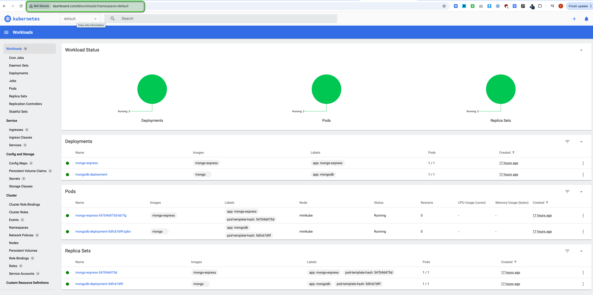

# Exposing the Kubernetes Dashboard with an Ingress

In this project I made the Kubernetes Dashboard on my local Minikube cluster reachable through a friendly domain name, `dashboard.com`, instead of a port-forward or a random NodePort. To do that I set up an Ingress, which works as the cluster's front door: it looks at the host name of each incoming request and sends it to the right service inside the cluster.

 

## How it works

A request travels from the browser to the dashboard in four steps:

1. My computer looks up `dashboard.com` and finds that it points to my own machine.
2. A Minikube tunnel carries the request from my machine into the cluster.
3. The NGINX Ingress Controller receives the request and checks the Ingress rules.
4. The rule for `dashboard.com` sends the request on to the Kubernetes Dashboard service.

 

## 1. Creating the Ingress

I started by defining an Ingress rule for the Kubernetes Dashboard. It says that all traffic for `dashboard.com` should go to the dashboard service. I placed the rule in the same namespace as the dashboard, and assigned it to the NGINX Ingress Controller, which is the component that carries out the routing.

After applying the configuration, I checked that Kubernetes had accepted the Ingress and linked it to the right host.

 

 
*The new `dashboard-ingress` is active, handled by NGINX and listening for `dashboard.com` on port 80.*

 

## 2. Pointing the domain to my machine

I don't own `dashboard.com`, so on its own the domain would lead nowhere. To fix that, I added a local entry to my computer's hosts file. It tells my machine that `dashboard.com` points to itself (`127.0.0.1`), so the browser sends the request to my local cluster instead of the internet.

 

 
*The hosts file entry that points `dashboard.com` to my own machine.*

 

## 3. Opening a tunnel into the cluster

Minikube runs the cluster in an isolated environment, so my machine can't reach it directly. I used `minikube tunnel` to open a connection between my computer and the cluster, which exposes the Ingress Controller on the standard web ports. The tunnel only works while the terminal running it stays open.

 

 
*The tunnel is running and forwarding traffic to the dashboard Ingress.*

 

## 4. Result

With everything in place, I opened `dashboard.com` in the browser and the Kubernetes Dashboard loaded. From there I can see the state of the cluster, including the MongoDB and Mongo Express applications running in the default namespace.

 

 
*The Kubernetes Dashboard served at `dashboard.com`, showing the workloads running in the cluster.*

 

## What I learned

- **An Ingress routes traffic by host name,** so a single entry point can serve many applications under different domains.
- **An Ingress needs an Ingress Controller,** such as NGINX, to actually carry out its rules.
- **A local setup needs two extra steps:** a hosts file entry to resolve the domain, and a Minikube tunnel to reach the cluster.
